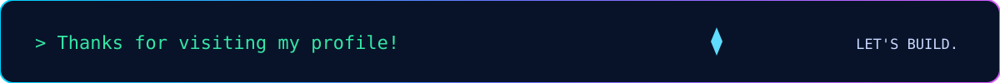

# Sahil Swami
### `CSE UNDERGRAD` · `JAVA` · `PYTHON`

**Interested in engineering practical solutions for real-world challenges.**

[GitHub](https://github.com/sahilbesierra) · [LinkedIn](https://www.linkedin.com/in/sahil-swami-7109b5388/)

`CREATE. BREAK. DEBUG. IMPROVE.`

---

## `01 / ABOUT.SYS`

- 🎓 CSE undergraduate interested in building useful, practical software.
- 🧠 Exploring **AI & Machine Learning** and **Cybersecurity**.
- 🛠️ Learning to use AI tools effectively to learn, develop, and ship projects.
- ⚡ I like turning ideas into working solutions through experimentation and iteration.

> **My approach:** Understand the fundamentals. Build with intent. Debug patiently. Improve continuously.

## `02 / SYSTEM.INFO`

| Parameter | Current setup |
|:--|:--|
| Primary languages | Java, Python |
| Database | Oracle SQL |
| Web fundamentals | HTML, CSS, JavaScript |
| Development tools | VS Code, Claude Code |
| Workflow | Git, GitHub, AI-assisted development, Prompt Engineering |
| Current mindset | Learn · Build · Improve |

## `03 / TECH.STACK`

**LANGUAGES**

**WEB FUNDAMENTALS**

**TOOLS & DATABASE**

- **Java:** OOP, Collections, Exception Handling, JDBC, DSA
- **Python:** Fundamentals
- **AI workflows:** AI-assisted development, Prompt Engineering, Claude Code

## `04 / PROJECTS.EXE`

A few ideas and builds I'm exploring. Project descriptions and details will be updated as they evolve.

| Project | Idea |
|:--|:--|
| **Air Miles** | A digital travel logbook to record flights and track flight miles. |
| **Facade AI** | An AI-powered building facade inspection and maintenance intelligence platform. |
| **AAI ATS Manual RAG** | A Retrieval-Augmented Generation project based on AAI ATS manuals. |
| **Jan Awaaz** | A voice-based citizen grievance platform for reporting local issues. |

[Explore my repositories →](https://github.com/sahilbesierra?tab=repositories)

## `05 / GITHUB.TELEMETRY`

<!-- Dynamic profile statistics. Counts update from the GitHub profile data source. -->

> **Live activity note:** These cards fetch profile and contribution data from third-party GitHub stats services. Counts and graphs refresh when those services update; they are not a real-time feed of every action.

## `06 / CONTRIBUTION.MAP`

## `07 / CURRENT.FOCUS`

- Strengthening problem-solving and core programming fundamentals.
- Learning how to work effectively with AI tools and coding agents.
- Exploring practical applications in AI/ML and cybersecurity.
- Building projects, learning from feedback, and improving the implementation.

## `08 / CONNECT.NET`

I'm open to learning, collaborating, and discussing ideas around software development and technology.

- **GitHub:** [@sahilbesierra](https://github.com/sahilbesierra)
- **LinkedIn:** [Sahil Swami](https://www.linkedin.com/in/sahil-swami-7109b5388/)

Made with curiosity, code, and a willingness to keep learning.

